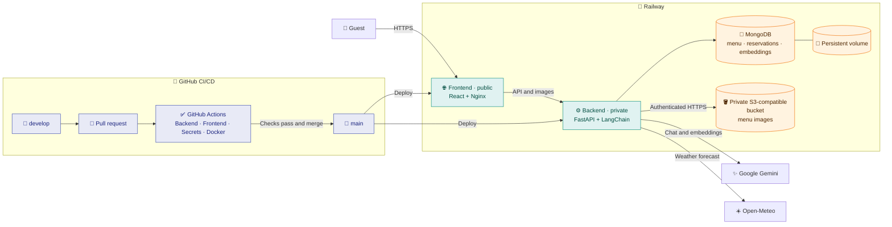

<div align="center">

# 🍽️ [RAGtaurant](https://rag-taurant.up.railway.app/)

**A fictional restaurant where AI helps guests explore the menu and its allergens.**

[](https://www.python.org/)
[](https://fastapi.tiangolo.com/)
[](https://react.dev/)
[](https://www.langchain.com/)
[](https://www.mongodb.com/)
[](https://www.docker.com/)
[](https://aws.amazon.com)
[](https://rag-taurant.up.railway.app/)
[](./LICENSE)


**[🌐 Open RAGtaurant](https://rag-taurant.up.railway.app/)**

[The story](#-the-story) · [Key features](#-key-features) · [How I built it](#️-how-i-built-it) ·
[Architecture](#️-architecture) · [Next steps](#-next-steps) · [Getting started](#-getting-started) ·
[CI/CD](#-cicd) · [License](#-license)

</div>

## 📖 The story

People close to me have serious food allergies, so I have often paid attention to how restaurants describe their
dishes and allergens. I noticed that this information is not always as clear as it should be.

I built RAGtaurant to explore a modern way to make that information easier to navigate, using AI and
Retrieval-Augmented Generation (RAG), technologies I learned about through my professional experience.
The restaurant and its menu are fictional; this project is a portfolio demonstration.

**Allergy information is illustrative.** The assistant can make mistakes and cannot guarantee the absence of an
allergen or cross-contact. Always confirm ingredients and preparation with restaurant staff.

## ✨ Key features

- 🍽️ **Andalusian menu:** Explore fictional dishes and drinks with dietary labels and recorded allergens.
- 🤖 **RAG assistant:** Ask about the menu, restaurant information or local weather in a conversation grounded in
  retrieved content.
- 📅 **Reservations:** Create, look up, update and cancel a reservation; lookup and changes require its code and
  contact details.
- ☀️ **Local information:** Discover the fictional restaurant, San Juan del Puerto and the local weather forecast.
- 🐳 **Local and deployed:** Run the stack with Docker Compose or visit the Railway deployment.

The demo sends chat content and text used for embeddings to Google Gemini. Use fictional contact details when
trying reservations; see the [development guide](./docs/local-development.md) for privacy and operational notes.

## 🛠️ How I built it

I used this project to explore four challenges:

1. 🧠 **From local models to grounded AI:** I first evaluated local models with Ollama, but latency and inconsistent
   grounding on the available hardware led me to move to hosted Google Gemini models. I combined Gemini, LangChain
   tools and embeddings with guardrails intended to keep answers grounded and within the app's scope, while
   recognizing that these safeguards cannot eliminate every risk. Read the
   [local model research](./docs/research/local-model-selection.md).
2. 🔗 **Connecting systems:** I integrated Google Gemini for chat and embeddings, Open-Meteo for weather forecasts,
   and S3-compatible storage for images: LocalStack locally and a Railway bucket in production.
3. 🍃 **Search across environments:** I used MongoDB Atlas Local vector search for development and an in-process
   cosine similarity fallback for Railway's MongoDB, where Atlas Vector Search is not available.
4. 🚀 **From local to live:** I built a React interface and FastAPI backend, orchestrated local services with Docker
   Compose, added GitHub Actions checks and deployed separate services to Railway.

## 🏗️ Architecture



In local development, MongoDB Atlas Local and LocalStack replace the Railway database and bucket.

## 🔭 Next steps

- **Evaluate the assistant:** Build a repeatable evaluation for retrieval quality, allergen questions and response latency.
- **Automate asset deployment:** Provision and synchronize the Railway bucket as part of a controlled deployment pipeline.
- **Strengthen reservation security:** Improve access controls and privacy protections for customer data.

## 🚀 Getting started

Clone the repository, copy `.env.example` to `.env` and add a Google Gemini API key:

```bash
git clone https://github.com/patriciorr/rag-taurant.git
cd rag-taurant
cp .env.example .env
# Set GOOGLE_API_KEY in .env; never commit the file.
docker compose up -d --build
```

Open [localhost](http://localhost). For prerequisites, manual setup, tests, configuration and deployment details, see
the [development guide](./docs/local-development.md).

## 🧪 CI/CD

Changes move from `develop` to `main` through a pull request. GitHub Actions checks the backend, frontend, secrets
and Docker builds; Railway deploys the connected services from `main`.

## 📜 License

Copyright © 2026 Patricio Rodríguez Ramírez. Licensed under the
[GNU Affero General Public License v3.0 only](./LICENSE). The menu photographs have separate
[source and licensing information](./docs/image-attribution.md).
